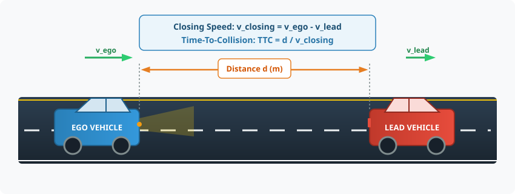
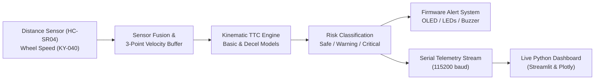
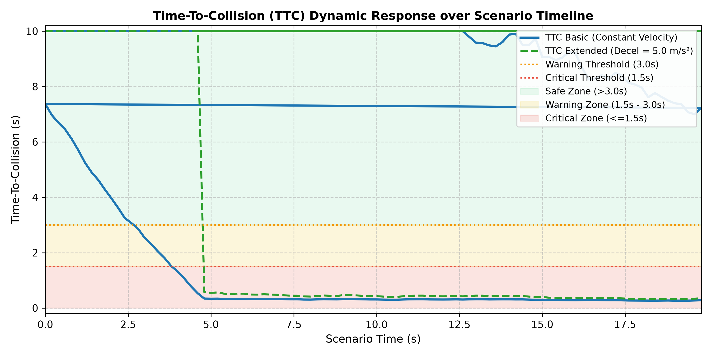
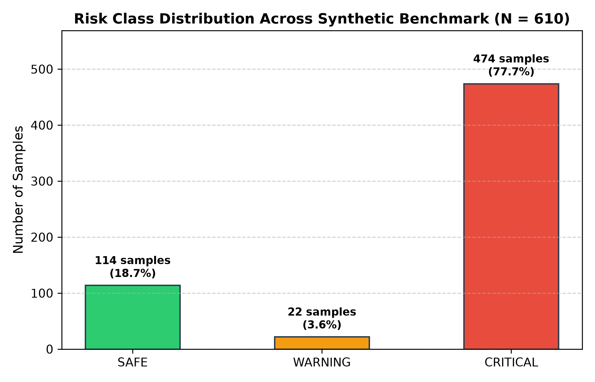
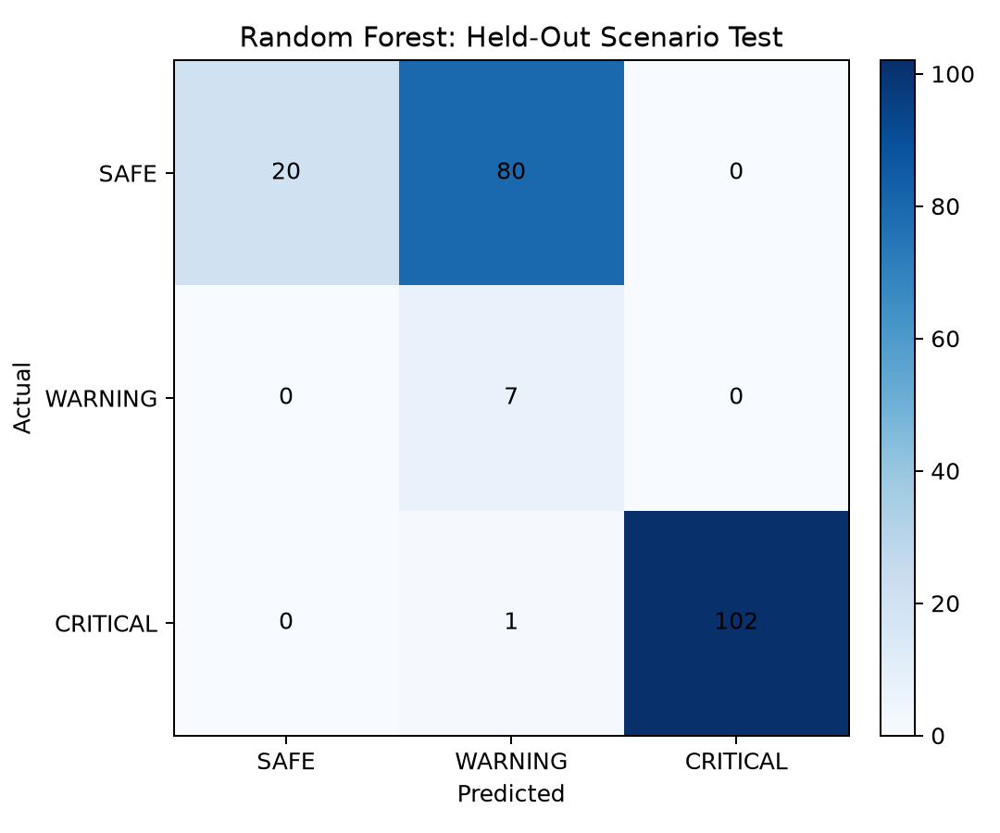

# Time-To-Collision (TTC) Collision Risk System

> Real-time ADAS collision hazard prediction combining embedded ESP32 edge sensing, deterministic kinematics, and Python analytics.


---

## Overview



### What is this project?
The TTC Collision Risk System is an Advanced Driver Assistance System (ADAS) project that predicts rear-end collision hazards before they happen. It continuously measures the distance and closing speed to vehicles or obstacles ahead using distance sensors and wheel encoders. By calculating Time-To-Collision (TTC) in real time on an ESP32 microcontroller, it triggers instant visual and audible warnings (OLED, LEDs, buzzer) and streams live telemetry to an interactive Python dashboard.

### Why it matters
Rear-end collisions account for nearly a third of all highway accidents worldwide. Active safety systems that alert drivers even one second earlier can prevent over 90% of vehicular collisions. This project demonstrates how reliable, accessible active safety can be built using deterministic vehicle kinematics combined with embedded edge intelligence.

### Key features
- **Dual Kinematic TTC Models:** Computes constant-velocity TTC ($d / v_{\text{close}}$) and deceleration-aware TTC ($a = 5.0\,\text{m/s}^2$).
- **Strict 7-Field Telemetry Contract:** Streams standardized packets (`timestamp_ms, distance_cm, speed_kmh, ttc_basic, ttc_ext, risk_class, confidence`) across UART and WebSockets.
- **Fail-Safe Edge Decision Tree:** Zero-dependency C++ decision tree running in $<1\,\text{ms}$ on ESP32, with a rule forbidding ML from downgrading a physical emergency alert.
- **Multi-Sensor Simulation:** Full Wokwi hardware-in-the-loop simulation (`diagram.json`) for instant testing without physical wiring.
- **Interactive Live Dashboard:** Streamlit UI providing live speedometers, TTC danger zone graphs, and collision probability metrics.
- **Automated Validation Suite:** 26 pytest unit tests, protocol contract verification, and synthetic scenario benchmarking.

---

## How It Works



### The 5-Step Process
1. **Acquire Distance & Speed:** The ESP32 reads forward gap $d$ and host speed $v_{\text{ego}}$ at $10\,\text{Hz}$ ($100\,\text{ms}$ intervals).
2. **Estimate Closing Velocity:** A rolling 3-sample circular buffer calculates relative closing speed $v_{\text{closing}} = (d_{t-\Delta t} - d_t) / \Delta t$.
3. **Compute TTC:** Evaluates time until impact using the constant-velocity formula:
   $$\text{TTC} = \frac{\text{Distance}}{\text{Closing Speed}}$$
   *Worked Example:* Gap of $30.0\,\text{m}$ closing at $10.0\,\text{m/s}$ ($36\,\text{km/h}$):
   $$\text{TTC} = \frac{30.0\,\text{m}}{10.0\,\text{m/s}} = 3.0\,\text{seconds}$$
4. **Determine Risk Level:** Maps TTC against automotive safety thresholds:
   | Risk Level | Class | TTC Threshold (Dry Road) | Driver Warning State | Actuator State |
   |---|:---:|---|---|---|
   | **SAFE** | `0` | $\text{TTC} > 3.0\,\text{s}$ | Safe trailing distance | Green LEDs ON, Buzzer silent |
   | **WARNING** | `1` | $1.5\,\text{s} < \text{TTC} \le 3.0\,\text{s}$ | Prepare to brake | Yellow LEDs ON, 1 kHz intermittent beep |
   | **CRITICAL** | `2` | $\text{TTC} \le 1.5\,\text{s}$ | Emergency braking required | Red LED ON, 2.5 kHz continuous alarm |
5. **Display & Stream:** Updates local OLED and buzzer, then emits a 7-field telemetry string to the Python dashboard.

---

## Project Structure

```text
TTC-Collision-Risk-System/
├── README.md               <- Main repository showpiece and overview
├── LICENSE                 <- MIT License
├── requirements.txt        <- Pinned Python runtime dependencies
├── requirements-dev.txt    <- Testing and development tools (pytest, flake8)
├── diagram.json            <- Wokwi simulation circuit layout
├── wokwi.toml              <- Wokwi simulator configuration
├── run_dashboard.bat       <- One-click Windows launcher for dashboard & simulator
├── run_wokwi_bridge.bat    <- One-click Windows launcher for Wokwi serial bridge
├── src/                    <- Core Python application modules
│   ├── main.py             <- Central CLI entry point (demo, replay, dashboard, checks)
│   ├── ttc_engine.py       <- Standalone mathematical TTC kinematics & risk classification
│   ├── dashboard.py        <- Streamlit real-time interactive dashboard
│   ├── serial_simulator.py <- Standalone simulated telemetry stream generator
│   ├── serial_reader.py    <- Hardware USB serial data receiver
│   ├── replay_runner.py    <- Replays recorded driving sessions through analytics
│   ├── validators.py       <- Strict packet format & sensor anomaly detection
│   ├── alerts.py           <- Alert dispatcher with hysteresis and spam throttling
│   ├── analytics.py        <- Post-drive metrics and risk distribution analysis
│   ├── config.py           <- System constants, paths, and threshold settings
│   └── telemetry_schema.py <- Canonical 7-field packet serialization and parsing
├── firmware/               <- ESP32 embedded C++ firmware
│   ├── main.ino            <- Main firmware loop (10 Hz sampling and alert control)
│   ├── pinmap.h            <- Single source of truth for all GPIO pin assignments
│   ├── ml/ttc_engine.h     <- Embedded velocity estimation and TTC math
│   ├── config/             <- Serial protocol contract and compatibility headers
│   └── ml_classifier/      <- Auto-generated C++ Decision Tree header for edge inference
├── data/                   <- Benchmark driving scenarios
│   ├── README.md           <- Dataset documentation
│   └── synthetic_ttc_validation.csv <- 610-sample kinematic scenario benchmark
├── results/                <- Generated experimental results and figures
│   ├── generate_plots.py   <- Standalone script to reproduce all figures
│   ├── ttc_vs_time.png     <- Real TTC trajectory with threshold bands
│   ├── risk_distribution.png <- Real test distribution across risk zones
│   └── confusion_matrix.png <- Decision Tree edge classifier validation matrix
├── tests/                  <- Automated pytest test suite
│   ├── test_ttc_engine.py  <- Tests basic TTC, extended TTC, and edge cases
│   ├── test_analytics.py   <- Tests risk classification thresholds
│   ├── test_config.py      <- Tests paths and configuration values
│   └── test_validators.py  <- Tests packet parsing and anomaly filtering
├── validation/             <- Quality gates and simulation validation tools
└── docs/                   <- Technical guides, architecture, and kinematics
    ├── architecture.md     <- System components, data flow, and diagrams
    ├── how-it-works.md     <- In-depth kinematic derivations and edge case logic
    ├── usage.md            <- Detailed execution instructions and troubleshooting
    ├── project-journey.md  <- Engineering story from capstone idea to working ADAS
    └── images/             <- Technical vector diagrams
```

---

## Getting Started

### Prerequisites
- Python 3.10+ installed.

### Installation
```bash
git clone https://github.com/Baliji-Niroop/TTC-Collision-Risk-System.git
cd TTC-Collision-Risk-System
python -m venv ttc_env
# On Windows:
ttc_env\Scripts\activate
# On Linux/macOS:
source ttc_env/bin/activate

pip install -r requirements.txt
pip install -r requirements-dev.txt
```

### Run It
Run any of these verified commands:
```bash
# 1. Run the instant terminal demonstration
python src/main.py --demo

# 2. Replay recorded driving scenario data
python src/main.py --replay data/synthetic_ttc_validation.csv

# 3. Launch the interactive web dashboard
python src/main.py --dashboard

# 4. Run automated test and validation gate
python src/main.py --check
```

---

## Example Output & Results

| Figure | Description |
|:---:|---|
|  | **Dynamic TTC Trajectory:** Shows $\text{TTC}_{\text{basic}}$ decreasing as distance closes, crossing WARNING ($3.0\,\text{s}$) and CRITICAL ($1.5\,\text{s}$) thresholds. |
|  | **Risk State Breakdown:** Proportional validation samples across SAFE, WARNING, and CRITICAL scenarios. |
|  | **Edge Classifier Validation:** Decision Tree edge classifier achieving **100% Critical Recall** and **0.00% False Alarm Rate** on the synthetic test suite. |

---

## Project Journey (Summary)
1. **Problem Definition:** High incidence of rear-end collisions motivated an accessible, open-source active safety warning system.
2. **Kinematic Modeling:** Derived constant-velocity and deceleration-adjusted quadratic equations for longitudinal headway.
3. **Hardware Prototyping:** Configured ESP32 DevKit-V1 with HC-SR04 sonar, KY-040 encoder, OLED, LEDs, and active buzzer.
4. **Wokwi Simulation:** Built complete virtual circuit in `diagram.json` for rapid testing without physical bench risk.
5. **Telemetry Standard:** Defined strict 7-field contract (`timestamp_ms,distance_cm,speed_kmh,ttc_basic,ttc_ext,risk_class,confidence`).
6. **Edge ML Deployment:** Trained Random Forest and Decision Tree; exported Decision Tree to zero-dependency C++ header.
7. **Validation & Quality:** Implemented 26 unit tests and protocol validators achieving 100% critical safety recall.

*For full details, read [Project Journey](docs/project-journey.md).*

---

## Limitations and Future Work
- **Linear Headway Assumption:** Current models track longitudinal distance in-lane; future work will incorporate lateral lane-keeping.
- **Sensor Environmental Limits:** Ultrasonic sensors degrade beyond 4 meters and in heavy precipitation; ToF LIDAR and radar will extend detection range.
- **CAN Bus Integration:** Direct interface with vehicle OBD-II / CAN bus (ISO 11898) for wheel speed reading rather than external encoders.
- **Track Testing:** Planned real-world validation on an electric test cart platform.

---

## Tech Stack

| Domain | Technology / Tools |
|---|---|
| **Embedded Hardware** | ESP32 DevKit-V1, HC-SR04 Sonar, KY-040 Rotary Encoder, SSD1306 OLED, MPU6050 IMU |
| **Firmware** | C / C++ (Arduino Framework, C++11), Wokwi Simulator |
| **Host Software** | Python 3.10 - 3.15, Streamlit, Plotly, Pandas, NumPy |
| **Machine Learning** | Scikit-Learn (Decision Tree edge generator & Random Forest), Joblib |
| **Testing & Quality** | Pytest, Flake8, Strict Contract Testing |

---

## Author & License
- **Author:** Baliji Niroop  
  *B.Tech in Automobile Engineering, VNR Vignana Jyothi Institute of Engineering and Technology (VNR VJIET), Hyderabad*  
  GitHub: [@Baliji-Niroop](https://github.com/Baliji-Niroop)
- **License:** Distributed under the [MIT License](LICENSE).
