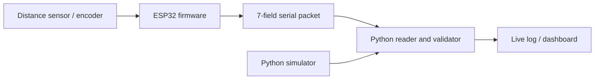

# Time-to-Collision (TTC) Collision Risk System

> A learning project combining ESP32 firmware, TTC threshold logic, serial telemetry, and a Python dashboard.


> **30-second Quick Start**
> No hardware is needed for the terminal demo. From the repository root, with the project dependencies installed, run:
> ```bash
> python src/main.py --demo
> ```
> On Windows, `run_dashboard.bat` starts the telemetry simulator and dashboard.

---

## Overview


### What is this project?

This project calculates time-to-collision from distance and closing speed, assigns SAFE, WARNING, or CRITICAL risk states, and demonstrates telemetry viewing with an ESP32 firmware sketch and Python tools. The repository includes simulation and synthetic data; it does not demonstrate a road-tested ADAS.

### Key features

- Basic and deceleration-aware TTC calculations in the firmware and Python demo.
- A fixed seven-field telemetry packet: `timestamp_ms,distance_cm,speed_kmh,ttc_basic,ttc_ext,risk_class,confidence`.
- ESP32 firmware source, pin map, and Wokwi circuit definition.
- Streamlit dashboard with simulated, live-log, and serial input modes.
- Optional trained Random Forest for the dashboard; the dashboard uses TTC rules when no model is available.
- A training script that exports a trained threshold decision tree for optional firmware use. The firmware flag is off by default.

**Honest note:** The checked-in evaluation data is synthetic, and its labels are generated from TTC threshold rules. Results measure this code pipeline on held-out synthetic scenarios; they do not measure real-world collision prediction accuracy.

---

## How It Works



**Caption:** Sensor values are processed by ESP32 firmware or a local simulator and displayed by the Python dashboard.

The firmware samples on its configured 100 ms cadence. It calculates TTC, classifies risk using the configured thresholds, updates outputs, and emits the canonical CSV packet at 115200 baud. See [architecture and diagrams](docs/architecture.md) and [how TTC is calculated](docs/how-it-works.md).

---

## Project Structure

```text
TTC-Collision-Risk-System/
├── README.md
├── TTC.ino                  # Arduino/Wokwi sketch wrapper
├── diagram.json             # Wokwi circuit
├── firmware/                # ESP32 source, pin map, and protocol
├── src/                     # Python CLI, dashboard, simulator, and validation
├── ml/                      # Optional model training and inference
├── data/                    # One checked-in synthetic dataset
├── results/                 # Reproducible plots and held-out metrics
├── tests/                   # Pytest suite
├── validation/              # Protocol and synthetic evaluation scripts
├── hardware/                # Wiring and assembly guides
└── docs/                    # Guides, diagrams, and developer notes
```

`TTC.ino` includes `firmware/main.ino`; `wokwi.toml` refers to build artifacts named `TTC.ino.bin` and `TTC.ino.elf`.

---

## Getting Started

### Requirements and installation

Python 3.10, 3.11, or 3.12 is supported. From a clone, create and activate a virtual environment, then install both runtime and development requirements:

```bash
python -m venv .venv
# Windows: .venv\Scripts\activate
# Linux/macOS: source .venv/bin/activate
python -m pip install -r requirements.txt
python -m pip install -r requirements-dev.txt
```

### Run the project

Run these commands from the repository root:

```bash
# 1. Terminal TTC demonstration (no hardware)
python src/main.py --demo

# 2. Replay the checked-in synthetic scenarios
python src/main.py --replay data/synthetic_ttc_validation.csv

# 3. Launch Streamlit (choose Simulator in the sidebar)
python src/main.py --dashboard

# 4. Run pytest and protocol/pin checks
python src/main.py --check
```

The dashboard stays open until stopped. On Windows, `run_dashboard.bat` starts the simulator and dashboard together. See [usage and troubleshooting](docs/usage.md).

### FAQ

- **No hardware?** Use `--demo` for the terminal demonstration, select **Simulator** in the dashboard, or open the Wokwi circuit after preparing its firmware build artifacts.
- **Why does evaluation need a model?** Run `python ml/training/train_model.py` first. The evaluation script deliberately errors when the model is missing; it never scores a fallback as a trained model.
- **Can I use the results as road-safety evidence?** No. Data and labels are synthetic. Real-world validation is still needed.

---

## Example Output & Results

Scenario-held-out synthetic evaluation: 400 training rows from four scenarios and 210 test rows from two scenarios.

| Classifier | Accuracy | CRITICAL recall | CRITICAL false-alarm rate |
|---|---:|---:|---:|
| Random Forest (dashboard model) | 61.43% | 99.03% | 0.00% |
| Threshold decision tree (firmware export) | 99.05% | 99.03% | 0.00% |
| TTC rule baseline | 100.00% | 100.00% | 0.00% |

The rule baseline reproduces the TTC rules used to create the labels. Its perfect score is expected and is not evidence of real-world accuracy.

| Figure | Description |
|---|---|
|  | TTC curves from the synthetic scenarios; see [results and metrics](results/README.md). |
|  | Class distribution in the generated dataset. |
|  | Random Forest predictions on held-out scenarios, not training rows. |


_Caption: Streamlit dashboard running with the built-in simulator._


_Caption: Short capture of the live dashboard while simulated telemetry updates._

**Wokwi screenshot:** TODO — capture a real Wokwi run after the firmware build artifacts are available.

---

## Project Journey (Summary)

1. Define TTC kinematics and SAFE/WARNING/CRITICAL thresholds.
2. Implement ESP32 sensor, alert, and serial packet code.
3. Add a Python simulator, telemetry validation, replay tools, and dashboard.
4. Add optional Random Forest training and C++ threshold-tree export.
5. Add scenario-held-out evaluation to avoid testing on rows from training scenarios.

See the [project journey](docs/project-journey.md) for implementation status and limitations.

### Project status

| Done | Simulated only | Planned |
|---|---|---|
| Python TTC demo, dashboard, telemetry parser, and ESP32 firmware source are present. | The checked-in circuit and generated scenarios are simulations; Wokwi requires local build artifacts. | Physical vehicle testing, road validation, and CAN integration. |

The presence of firmware and wiring instructions does not mean the system has been assembled or road-tested.

### Verification scope

`python src/main.py --check` runs the Python tests, telemetry protocol contract,
firmware pin-map validator, and Flake8. These checks verify the source-level
prototype; ESP32 compilation and real sensor or road validation remain separate
hardware steps. The dashboard resolves one final risk state before it renders,
logs, or dispatches an alert, and telemetry rows with non-finite numeric values
are rejected at the validation boundary.

---

## Limitations and Future Work

- TTC uses a simplified longitudinal approach model; it does not track lanes or predict other vehicles' paths.
- Synthetic data cannot establish performance with real sensors, traffic, or collisions.
- Confirm sensor voltage compatibility and signal conditioning before physical wiring.
- Physical testing, CAN input, and additional sensor fusion remain future work.

---

## Tech Stack

| Domain | Technology |
|---|---|
| Embedded | ESP32 Arduino firmware, Wokwi circuit description |
| Host | Python 3.10–3.12, Streamlit, Pandas, NumPy, Plotly |
| Optional model | scikit-learn Random Forest and Decision Tree training |
| Quality | pytest, protocol contract script, Flake8 |

---

## Author & License

- **Author:** Baliji Niroop — [GitHub](https://github.com/Baliji-Niroop)
- **License:** [MIT](LICENSE)
