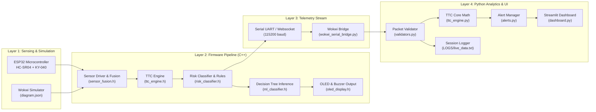
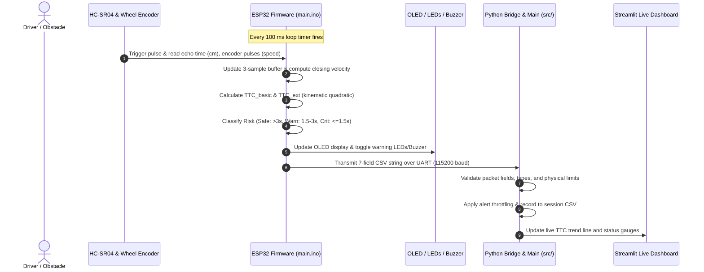

# System Architecture

This document describes the modular architecture, hardware-software interfaces, data flow, and code ownership across the TTC Collision Risk System.

---

## 1. System Pipeline Overview

---

## 2. Component Responsibility Matrix

| Layer | Module / File | Responsibility |
|---|---|---|
| **Entry Point** | `src/main.py` | Unified command-line interface for demo, session replay, dashboard launch, and verification. |
| **Kinematics Engine** | `src/ttc_engine.py` | Standalone, unit-tested implementation of basic TTC, extended deceleration TTC, and risk thresholding. |
| **Embedded Firmware** | `firmware/main.ino` | High-frequency execution loop ($10\,\text{Hz}$ / $100\,\text{ms}$) on ESP32; drives sensors and actuators. |
| **Pin Mapping** | `firmware/pinmap.h` | Authoritative single source of truth for all GPIO assignments matching `diagram.json`. |
| **Embedded Math** | `firmware/ml/ttc_engine.h` | Fixed circular buffer closing velocity estimator and C++ TTC calculations. |
| **Telemetry Contract** | `firmware/config/serial_protocol.h`   `src/telemetry_schema.py` | Serializes and parses the frozen 7-field telemetry string: `timestamp_ms,distance_cm,speed_kmh,ttc_basic,ttc_ext,risk_class,confidence`. |
| **Data Ingestion** | `src/serial_reader.py`   `bridge/wokwi_serial_bridge.py` | Reads streaming telemetry over physical serial COM ports or Wokwi websockets. |
| **Validation & Safety** | `src/validators.py`   `src/safety_features.py` | Checks packet syntax, handles sensor dropout, implements risk hysteresis deadbands, and ML-physics arbitration. |
| **Visualization** | `src/dashboard.py` | Live interactive web dashboard with speedometers, TTC line charts, and danger alerts. |

---

## 3. Communication Sequence Diagram

The sequence diagram below illustrates the exact timing and data propagation of a single sensor acquisition cycle ($100\,\text{ms}$):

---

## 4. Hardware Pin Mapping & Circuit Layout

All physical wiring on the ESP32 DevKit-V1 is mapped deterministically in `firmware/pinmap.h`:

| Function | Signal | ESP32 GPIO | Connected Component |
|---|---|:---:|---|
| Front Ultrasonic Sensor | Trigger (`TRIG`) | **GPIO 5** | HC-SR04 Front Sensor |
| Front Ultrasonic Sensor | Echo (`ECHO`) | **GPIO 18** | HC-SR04 Front Sensor |
| Secondary Sonar | Trigger (`TRIG`) | **GPIO 4** | HC-SR04 Rear/Aux Sensor |
| Secondary Sonar | Echo (`ECHO`) | **GPIO 16** | HC-SR04 Rear/Aux Sensor |
| Wheel Encoder | Clock (`CLK`) | **GPIO 19** | KY-040 Rotary Encoder |
| Wheel Encoder | Data (`DT`) | **GPIO 23** | KY-040 Rotary Encoder |
| I2C Bus | Data (`SDA`) | **GPIO 21** | SSD1306 OLED (0x3C), MPU6050 (0x68) |
| I2C Bus | Clock (`SCL`) | **GPIO 22** | SSD1306 OLED (0x3C), MPU6050 (0x68) |
| Active Buzzer | Alarm Signal | **GPIO 32** | 5V Active Piezo Buzzer |
| Warning Actuator | Red LED (Critical) | **GPIO 12** | Ultra-bright Red LED |
| Warning Actuator | Yellow LED 1 (Warning) | **GPIO 27** | Amber LED 1 |
| Warning Actuator | Yellow LED 2 (Warning) | **GPIO 14** | Amber LED 2 |
| Safe Headway Actuator | Green LED 1 (Safe) | **GPIO 25** | Green LED 1 |
| Safe Headway Actuator | Green LED 2 (Safe) | **GPIO 26** | Green LED 2 |
