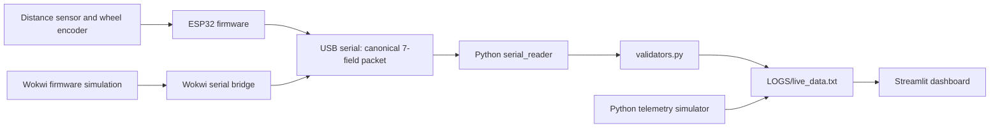
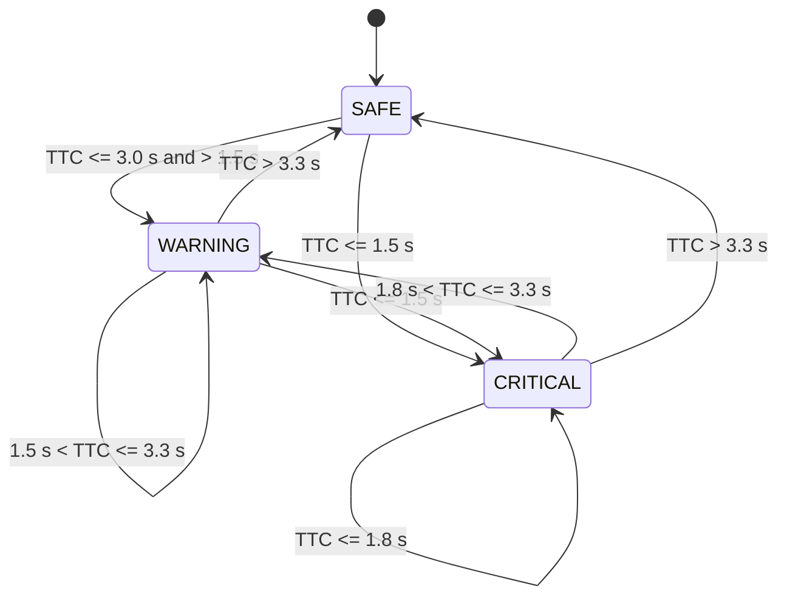
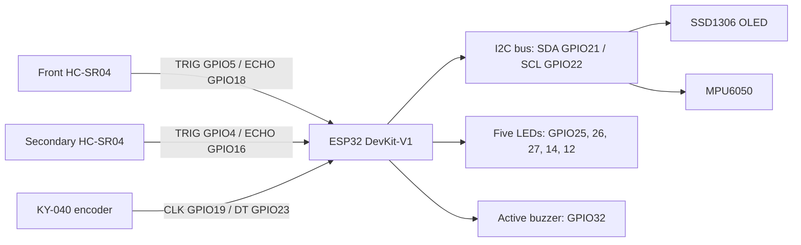
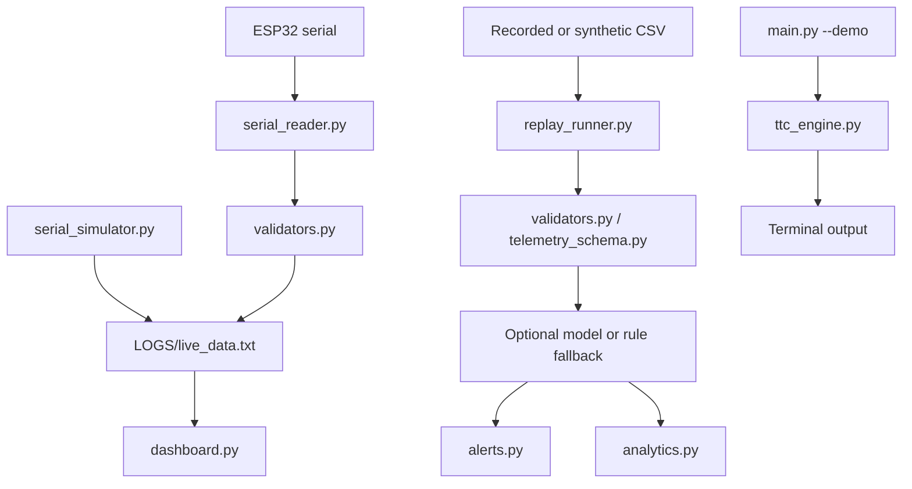
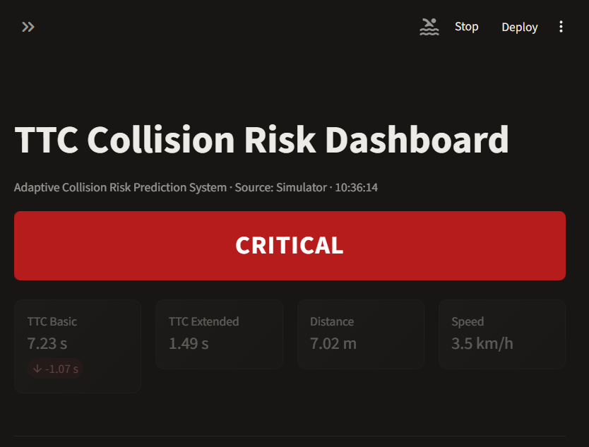
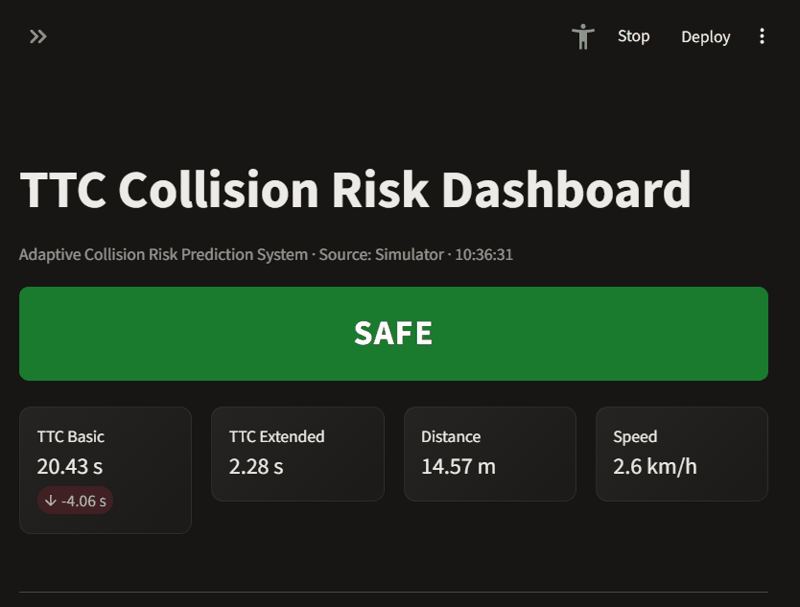

# Architecture and Diagrams

## 1. System architecture



**Caption:** Firmware and Python simulation provide telemetry to the host validator and dashboard.

The Wokwi bridge forwards the simulator's stream to the configured virtual serial port. The bridge output port and serial reader port must be paired but different ports.

## 2. Risk states and hysteresis



**Caption:** The threshold helper uses 1.5 s and 3.0 s boundaries and a 0.3 s de-escalation deadband.

The base risk thresholds are defined in [`src/config.py`](../src/config.py). A 0.3 s deadband is configured by `RiskHysteresisFilter` in [`src/safety_features.py`](../src/safety_features.py). That helper is initialized by validation code but is not wired into the live dashboard's risk classification. [`src/alerts.py`](../src/alerts.py) throttles alert messages; it does not implement risk-state hysteresis. The state diagram documents the helper's behavior, not a claim that the live dashboard applies it.

## 3. One firmware loop and telemetry packet

```mermaid
sequenceDiagram
    participant Timer as Firmware loop
    participant Sensor as Distance sensor / encoder
    participant Calc as TTC and risk code
    participant Output as LEDs / buzzer
    participant Host as Serial host
    Note over Timer: Sample when PACKET_INTERVAL_MS has elapsed (100 ms)
    Timer->>Sensor: Read distance and host speed
    Timer->>Calc: Estimate closing speed; calculate TTC values
    Calc->>Calc: Classify risk (roadCondition is currently 0)
    Calc->>Output: Update indicators
    Calc->>Host: Emit one newline-terminated packet at 115200 baud
```

**Caption:** Each due firmware sample reads sensors, calculates risk, updates outputs, and sends one packet.

Packet shape (values vary with the sensor readings):

```text
timestamp_ms,distance_cm,speed_kmh,ttc_basic,ttc_ext,risk_class,confidence
```

The loop cadence is configured in [`firmware/config/config.h`](../firmware/config/config.h); packet serialization is in [`firmware/config/serial_protocol.h`](../firmware/config/serial_protocol.h). The optional firmware tree is disabled by default.

## 4. Hardware wiring



**Caption:** Signal assignments follow [`firmware/pinmap.h`](../firmware/pinmap.h) and the [hardware wiring guide](../hardware/wiring_guide.md).

The diagram summarizes signal pins; it is not a complete power or signal-conditioning schematic. Check the wiring guide before connecting physical components.

## 5. Python data flows



**Caption:** Live telemetry is validated and written to a log; replay uses the analytics pipeline, while the terminal demo uses the standalone TTC engine.

The current live dashboard reads the log or its own simulator. It does not route packets through `ttc_engine.py` and `analytics.py`; those modules are used by the demo and replay paths respectively.

## 6. Dashboard capture



**Caption:** Real browser capture of the dashboard running with simulated telemetry.



**Caption:** Short real capture of the dashboard as simulator values refresh.

## Main code areas

| Area | Files |
|---|---|
| Firmware entry and pin map | `firmware/main.ino`, `firmware/pinmap.h` |
| Firmware protocol and thresholds | `firmware/config/serial_protocol.h`, `firmware/config/config.h` |
| Python CLI and dashboard | `src/main.py`, `src/dashboard.py` |
| Serial ingestion and validation | `src/serial_reader.py`, `src/validators.py`, `src/telemetry_schema.py` |
| Local simulation and replay | `src/serial_simulator.py`, `src/replay_runner.py` |
| Optional model training | `ml/training/train_model.py`, `ml/inference/__init__.py` |
