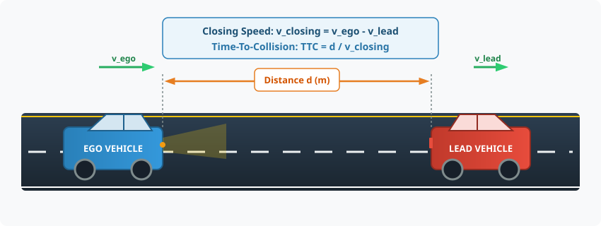
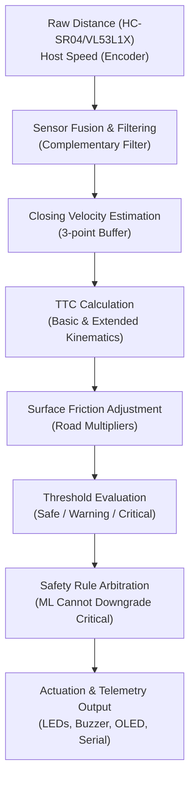

# How It Works: Time-To-Collision (TTC) & Risk Prediction

This document breaks down the mathematics, sensor inputs, edge cases, and safety logic behind the TTC Collision Risk System.

---

## 1. Physical Scenario & Geometry

In a longitudinal rear-end collision scenario, an **Ego Vehicle** (the vehicle carrying our ADAS unit) follows a **Lead Vehicle** or approaches a stationary obstacle in the same travel lane.

### State Variables
- $d$: Current longitudinal separation distance between the front bumper of the ego vehicle and the rear of the lead vehicle (meters, $\text{m}$).
- $v_{\text{ego}}$: Speed of the ego vehicle over the road (meters per second, $\text{m/s}$).
- $v_{\text{lead}}$: Speed of the target vehicle ahead (meters per second, $\text{m/s}$).
- $v_{\text{closing}}$: Relative closing speed at which the gap is closing:
  $$v_{\text{closing}} = v_{\text{ego}} - v_{\text{lead}} = -\frac{\Delta d}{\Delta t}$$
- $a$: Maximum available emergency braking deceleration (typically $5.0\,\text{m/s}^2$ on dry asphalt).

---

## 2. Mathematical Formulations

### A) Basic TTC (Constant Velocity Model)
The fundamental definition of Time-To-Collision assumes that both vehicles maintain their instantaneous speeds without accelerating or braking:

$$\text{TTC}_{\text{basic}} = \frac{d}{v_{\text{closing}}}$$

#### Numerical Example:
- Distance gap: $d = 30.0\,\text{m}$
- Relative closing speed: $v_{\text{closing}} = 10.0\,\text{m/s}$ ($36.0\,\text{km/h}$)
$$\text{TTC} = \frac{30.0\,\text{m}}{10.0\,\text{m/s}} = 3.0\,\text{seconds}$$

### B) Extended TTC (Constant Deceleration Model)
When the driver or Autonomous Emergency Braking (AEB) initiates braking with deceleration $a$, the future gap distance $d(t)$ evolves according to standard kinematic motion:

$$d(t) = d - v_{\text{closing}} \cdot t + \frac{1}{2} a t^2$$

Setting $d(t) = 0$ gives the quadratic equation for the time of impact $t$:

$$\frac{1}{2} a t^2 - v_{\text{closing}} \cdot t + d = 0$$

The discriminant $\Delta$ determines if an impact will occur:

$$\Delta = v_{\text{closing}}^2 - 2 a d$$

- **Case 1: $\Delta < 0$ (Safe Stopping):** The available braking deceleration is sufficient to stop the relative closure before impact ($d_{\text{stop}} = \frac{v_{\text{closing}}^2}{2a} < d$). In this case, no collision occurs ($\text{TTC} \to \infty$, clamped to $99.0\,\text{s}$).
- **Case 2: $\Delta \ge 0$ (Collision Envelope):** The earliest physical impact occurs at the smaller positive root:
  $$\text{TTC}_{\text{ext}} = \frac{v_{\text{closing}} - \sqrt{v_{\text{closing}}^2 - 2 a d}}{a}$$

---

## 3. Risk Classification Pipeline

### Deterministic Risk Thresholds
The system uses safety thresholds aligned with automotive active safety standards:

| Risk Level | Class Code | TTC Condition (Dry Road) | Driver Warning State | Vehicle Alert Actuation |
|---|:---:|---|---|---|
| **SAFE** | `0` | $\text{TTC} > 3.0\,\text{s}$ | Nominal headway | Green LEDs ON, Buzzer silent |
| **WARNING** | `1` | $1.5\,\text{s} < \text{TTC} \le 3.0\,\text{s}$ | Approaching danger | Yellow LEDs ON, intermittent 1 kHz beep |
| **CRITICAL** | `2` | $\text{TTC} \le 1.5\,\text{s}$ | Imminent collision hazard | Red LED ON, continuous 2.5 kHz emergency alarm |

### Road Surface Adaptation
Friction coefficients ($\mu$) directly affect the required stopping distance. The firmware and analytics adjust thresholds dynamically via surface condition multipliers:
- **Dry Asphalt:** $1.0\times$ (Critical $\le 1.5\,\text{s}$, Warning $\le 3.0\,\text{s}$)
- **Wet Asphalt:** $1.4\times$ (Critical $\le 2.1\,\text{s}$, Warning $\le 4.2\,\text{s}$)
- **Gravel:** $1.6\times$ (Critical $\le 2.4\,\text{s}$, Warning $\le 4.8\,\text{s}$)
- **Snow / Ice:** $2.0\times$ (Critical $\le 3.0\,\text{s}$, Warning $\le 6.0\,\text{s}$)

---

## 4. Special Scenarios and Edge Cases

1. **Lead Vehicle Moving Faster ($v_{\text{lead}} > v_{\text{ego}}$):**
   - $v_{\text{closing}} \le 0$. The gap is widening.
   - Handled: System suppresses warning and sets $\text{TTC} = 99.0\,\text{s}$ (SAFE).
2. **Stationary Obstacle at Red Light:**
   - $v_{\text{lead}} = 0$, $v_{\text{closing}} = v_{\text{ego}}$.
   - Handled: TTC accurately tracks ego vehicle approach rate.
3. **Sensor Jitter & Dropout:**
   - Raw ultrasonic pulses can produce occasional $0\,\text{cm}$ or spike readings.
   - Handled: The 3-point rolling buffer and boundary validators reject single-sample anomalies.
4. **Collision Already Occurred ($d \le 0$):**
   - Handled: Directly returns $\text{TTC} = 0.0\,\text{s}$ and immediately triggers CRITICAL.
5. **Fail-Safe Arbitration Principle:**
   - If an optional edge Machine Learning model predicts `SAFE` while physical kinematic equations evaluate $\text{TTC} \le 1.5\,\text{s}$, **the physical CRITICAL state is strictly preserved**. Machine learning is never permitted to downgrade an emergency safety state.
