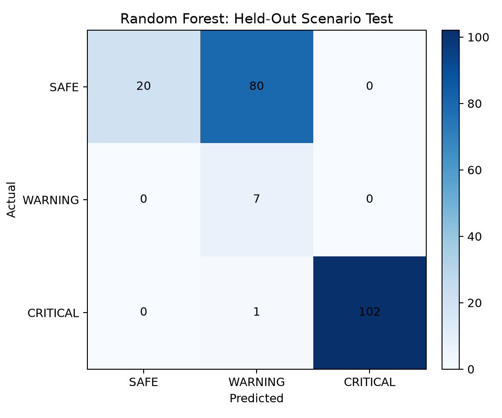
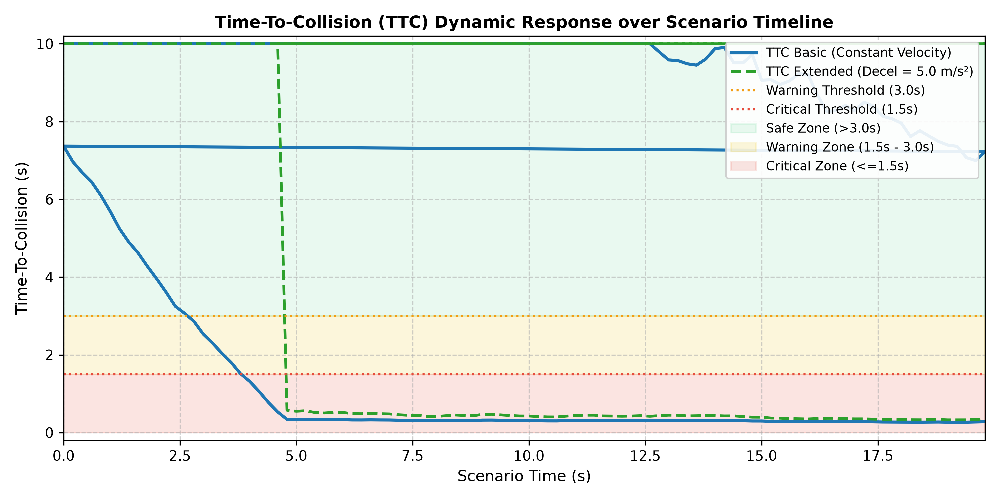
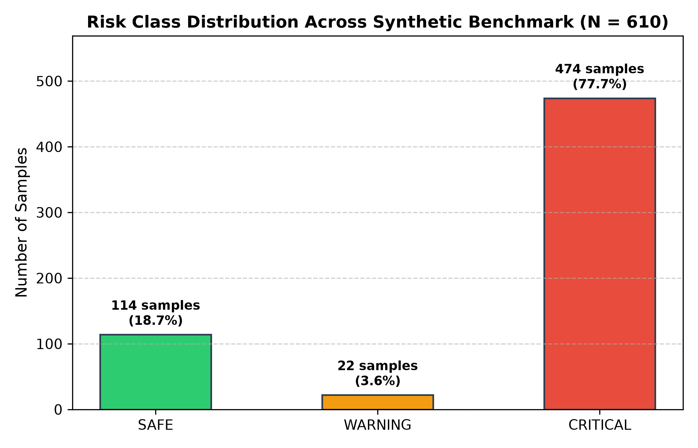

# Results

These results come from the checked-in synthetic dataset and a scenario-level split. They are pipeline checks, not real-world safety measurements.

## Held-out evaluation

Run the training command before evaluation:

```bash
python ml/training/train_model.py
python validation/evaluate_synthetic.py
```

The shared `GroupShuffleSplit` keeps whole scenario names on one side of the split. In the current generated dataset, training uses 400 rows from four scenarios; testing uses 210 rows from `safe_cruise` and `wet_road_threshold_shift`.

| Classifier | Accuracy | CRITICAL recall | CRITICAL false-alarm rate |
|---|---:|---:|---:|
| Random Forest (dashboard model) | 61.43% | 99.03% | 0.00% |
| Threshold decision tree (firmware export) | 99.05% | 99.03% | 0.00% |
| TTC rule baseline | 100.00% | 100.00% | 0.00% |



**Caption:** Random Forest predictions compared with rule-generated labels in the two held-out scenarios.

The rule baseline applies the TTC thresholds used to generate the labels. Its perfect score is expected and is not an independent measure of prediction performance. The Random Forest result also shows why the full score matters: it has low SAFE recall on this split despite high CRITICAL recall. These results should not be used to claim real-world accuracy.

The output files under `validation/outputs/` are generated locally and are not committed. `evaluate_synthetic.py` writes the confusion-matrix image above; `results/generate_plots.py` regenerates the TTC and dataset-distribution plots.

## Descriptive plots



**Caption:** Basic and extended TTC values from generated synthetic scenarios.



**Caption:** Risk labels across the complete generated synthetic dataset.
